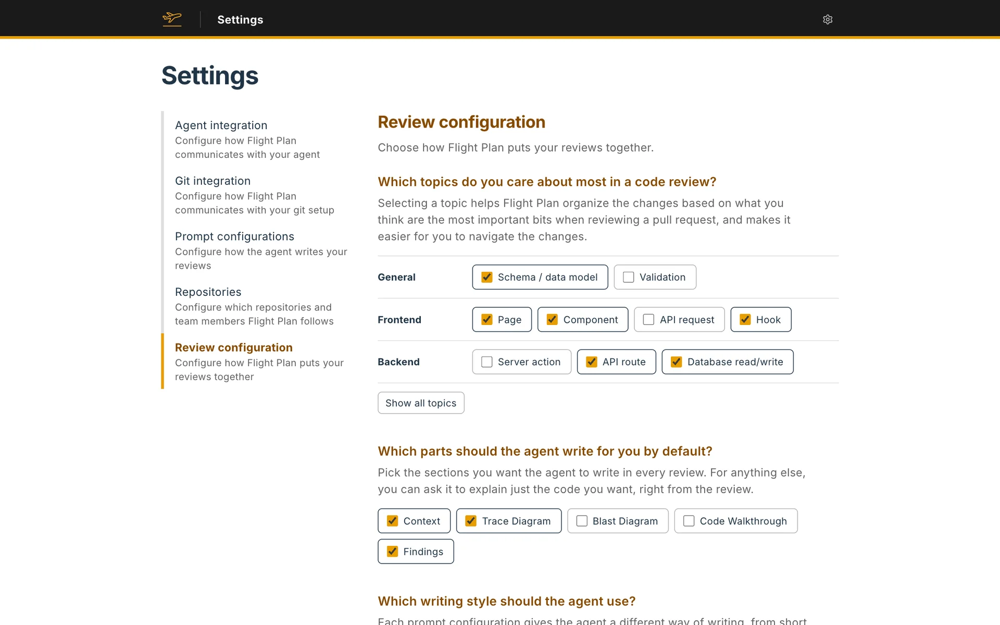

The last step of setup decides how Flight Plan puts your reviews together. Nothing on it is saved until **Finish setup**. Later, **Settings → Review configuration** holds the same form.

## Spotlight

**Which topics do you care about most in a code review?** Flight Plan classifies every changed block of code, such as a page, a component, an API route or a database read or write. The topics you pick get a spotlight. Their waypoints are marked **Spotlight**, they come first in the Code Walkthrough's filter, and they lead the **Most important first** order.

The topics come in five groups: General, Frontend, Backend, Infrastructure and Miscellaneous. The common ones show as chips, and **Show all topics** lists all 35. To start with, Page, Component, API route, Database read/write, Schema / data model and Hook are picked.

## What your agent writes by default

**Which parts should the agent write for you by default?** Pick the sections your agent writes each time it explains a review: Context, Trace Diagram, Blast Diagram, Code Walkthrough and Findings. For anything you leave out, you can ask it to explain just the code you want, right from the review. To start with, Context, Trace Diagram and Findings are picked.

## Writing style

**Which writing style should the agent use?** Pick the prompt configuration your agent follows by default. Four presets ship with Flight Plan:

| Preset | Best for |
|---|---|
| **Standard** | General pull requests. The agent writes the full review for a reviewer who knows the codebase. This is the default. |
| **Minimal** | Saving tokens. The agent writes in fragments, with few words and no filler. |
| **Onboardee** | Engineers who are new to the company and the codebase. The agent adds more about how the codebase works, and hovering a name in the code also shows what that code is, what it does and where the codebase uses it. |
| **Unfamiliar territory** | A pull request in a language or framework you don't know well. The agent adds more about how the technology works, and hovering a name also shows what it is and what it does, for the repository's code, the libraries it imports and the language itself. |

You can make your own under **Settings → Prompt configurations**, and pick another one each time you ask your agent to explain a review. See [Prompt configurations](/docs/presets/).

## Code Walkthrough order

The order the [Code Walkthrough](/docs/review-artifacts/parts/code-walkthrough/) takes you through the changed files. Flight Plan sorts them itself.

| Order | What you read first |
|---|---|
| **Building blocks first** (the default) | The files the rest of the change depends on, then the code that uses them. |
| **Entry points first** | Where the change is used, like pages and routes, then down to the details. |
| **Most important first** | The heart of the change and the topics you care about most, then the rest. |

Every changed file is covered whichever you choose.

## Advanced options

**Advanced options** holds three more settings.

- **Split reviews into segments**, off to start with. Flight Plan groups the changed files into [segments](/docs/review-artifacts/parts/segments/), each with its own Context, Trace Diagram, Blast Diagram and Code Walkthrough. With segments off, a review is one segment with one Context for the whole change, and the code several paths share is drawn in the Trace Diagram of each path that uses it.
- **Display arrangement**, the order of the four sections in each segment. To start with it's Context, Trace Diagram, Code Walkthrough, Blast Diagram.
- **Ignored files**, path patterns written from the root of the repository, as in a `.gitignore`. Flight Plan leaves the files they match out of every review. To start with, the list leaves out tests in TypeScript and Python, e2e tests included. **Add pattern** adds a row.
